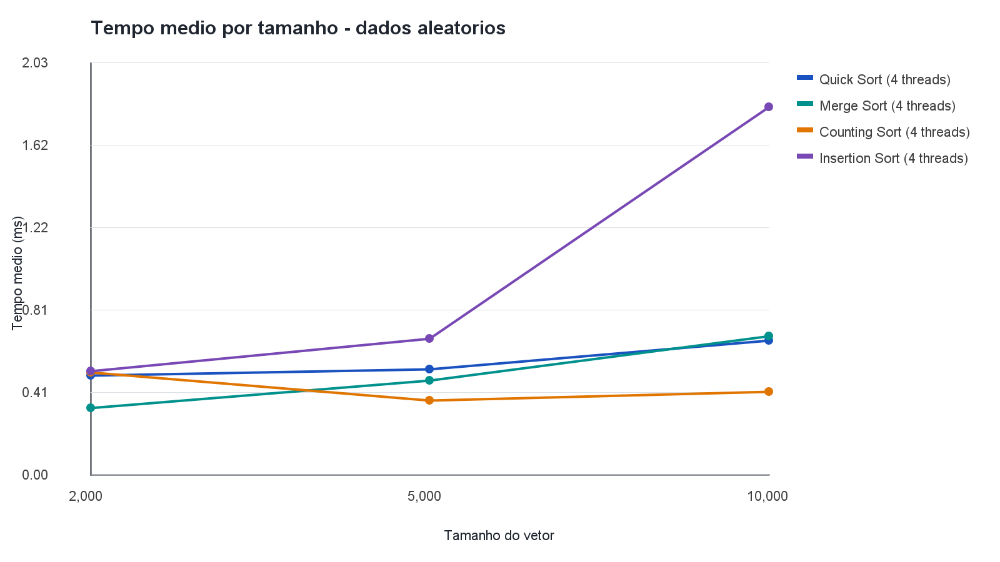
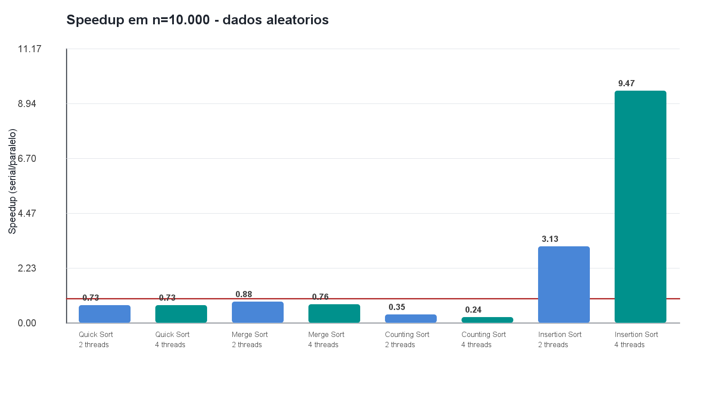
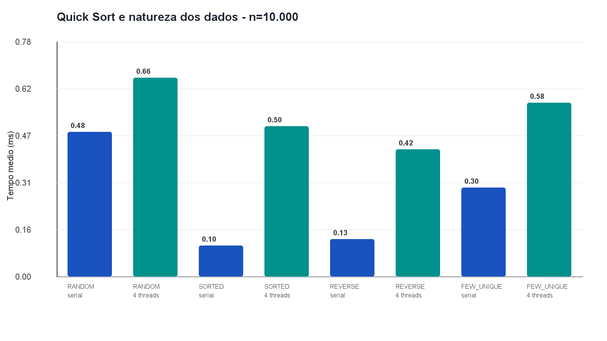

# Análise de desempenho de algoritmos de ordenação em Java

**Estudo comparativo em ambientes concorrentes e paralelos**  
Universidade de Fortaleza (Unifor) - Ciência da Computação

### Membros do grupo

- Levi de Pontes Lima Santos - matrícula 2516516
- Savas Constantin Petalas Neto - matrícula 2410432

**Repositório:** [github.com/savass33/analise-algoritmos-paralelos-java](https://github.com/savass33/analise-algoritmos-paralelos-java)

## Resumo

Este projeto compara quatro algoritmos de ordenação em Java, em versões sequenciais e paralelas: Quick Sort, Merge Sort, Counting Sort e Insertion Sort. O experimento usa vetores de 2.000, 5.000 e 10.000 elementos, quatro padrões de entrada e cinco amostras por configuração. As execuções paralelas usam 2 e 4 threads. Os tempos são registrados em CSV e resumidos com média, mediana, desvio-padrão amostral, mínimo, máximo, speedup e eficiência.

No experimento descrito originalmente no artigo, Counting Sort sequencial teve a menor média para dados aleatórios com 10.000 elementos, 0,132 ms. Quick Sort, Merge Sort e Counting Sort ficaram mais lentos nas configurações paralelas testadas. Insertion Sort em blocos teve médias menores no modo paralelo, mas esse ganho também decorre da mudança na decomposição do trabalho e não representa apenas escalabilidade por threads.

**Palavras-chave:** ordenação; paralelismo; concorrência; Java; desempenho.

## 1. Introdução

Ordenar dados é uma operação comum em sistemas de informação, bancos de dados e aplicações científicas. O desempenho observado depende da complexidade do algoritmo, do tamanho e da distribuição dos dados e dos custos de criação e coordenação de tarefas concorrentes.

Embora o enunciado da atividade use a expressão “algoritmos de busca”, os métodos listados e implementados neste projeto são algoritmos de **ordenação**. Por isso, esta documentação adota a terminologia tecnicamente correta.

## 2. Objetivos

- Implementar quatro algoritmos de ordenação em Java.
- Comparar as implementações sequenciais e paralelas.
- Variar tamanho e padrão dos vetores, além da quantidade de threads.
- Repetir cada configuração cinco vezes, validar as saídas e registrar os dados em CSV.
- Apresentar os resultados em tabelas, gráficos estáticos e um painel Swing interativo.

## 3. Algoritmos

- **Quick Sort:** particiona o vetor e processa segmentos recursivamente. A versão paralela usa `ForkJoinPool` e executa segmentos pequenos sequencialmente.
- **Merge Sort:** divide e intercala segmentos ordenados. A versão paralela usa `ForkJoinPool` e um vetor auxiliar compartilhado por intervalos não sobrepostos.
- **Counting Sort:** conta ocorrências de cada valor. Na versão paralela, cada thread cria um histograma local; as contagens são combinadas antes da reconstrução do vetor. O código limita o intervalo de valores para evitar alocações excessivas.
- **Insertion Sort:** ordena cada bloco com inserção e depois intercala os blocos. A versão paralela é híbrida: além do paralelismo, ela muda a decomposição do trabalho em comparação com a execução serial.

## 4. Metodologia

### Entradas e configurações do experimento original

| Fator | Configurações |
| --- | --- |
| Tamanho do vetor | 2.000, 5.000 e 10.000 elementos |
| Padrões | Aleatório, ordenado, inverso e poucos valores distintos |
| Execuções | Uma serial e paralelas com 2 e 4 threads |
| Amostras | Cinco por cenário e configuração |
| Ambiente declarado no artigo | Windows 11, Java 22 e quatro processadores lógicos visíveis à JVM |

As entradas são geradas com sementes determinísticas, registradas no CSV. Cada cenário recebe aquecimento antes das medições. `System.nanoTime()` mede a chamada de ordenação; geração, cópia da entrada e validação ficam fora do intervalo. A criação e o encerramento dos pools paralelos acontecem dentro da chamada medida. Ao fim de cada execução, o programa verifica a ordem crescente e a preservação dos elementos.

## 5. Resultados do experimento original

A tabela apresenta as médias e os desvios-padrão amostrais para vetores aleatórios com 10.000 elementos, conforme o CSV original incluído no pacote. Speedup maior que 1 significa que a média paralela foi menor que a serial.

| Algoritmo | Serial (ms) | 2 threads (ms) | Speedup 2 | 4 threads (ms) | Speedup 4 |
| --- | ---: | ---: | ---: | ---: | ---: |
| Quick Sort | 0,597 ± 0,138 | 4,216 ± 4,717 | 0,142 | 1,476 ± 0,549 | 0,405 |
| Merge Sort | 0,655 ± 0,039 | 0,953 ± 0,289 | 0,687 | 1,234 ± 0,530 | 0,530 |
| Counting Sort | 0,132 ± 0,012 | 0,540 ± 0,115 | 0,245 | 0,807 ± 0,090 | 0,164 |
| Insertion Sort | 28,232 ± 1,156 | 8,633 ± 0,851 | 3,270 | 5,496 ± 1,892 | 5,137 |

Counting Sort sequencial foi o mais rápido nesse cenário. Quick Sort, Merge Sort e Counting Sort ficaram mais lentos com 2 e 4 threads, pois o custo de criação de pools, tarefas, sincronização e combinação foi maior que o trabalho útil para esses tamanhos. A variabilidade do Quick Sort paralelo com 2 threads também foi alta, como mostra o desvio-padrão.

No Insertion Sort paralelo, os blocos reduzem o custo de ordenar cada trecho, e a etapa final os intercala. Por isso, o speedup observado mistura paralelismo com uma mudança no trabalho algorítmico. Ele não deve ser interpretado como eficiência física acima de 100%.

### Efeito do padrão dos dados no Quick Sort original

Médias em milissegundos para `n = 10.000`, conferidas com o CSV original:

| Padrão | Serial | 4 threads |
| --- | ---: | ---: |
| Aleatório | 0,597 | 1,476 |
| Ordenado | 0,113 | 1,655 |
| Inverso | 0,159 | 0,985 |
| Poucos valores distintos | 0,284 | 0,694 |

### Reexecução de validação no computador do grupo

A suíte de verificação passou em **288 casos**. Em seguida, o benchmark foi recompilado com `--release 17` e executado no computador abaixo. A reexecução gerou **720 medições válidas**, distribuídas em **144 grupos com cinco amostras cada**. Nenhuma medição foi marcada como inválida.

| Configuração | Computador usado na reexecução |
| --- | --- |
| Sistema operacional | Windows 11 Pro, 64 bits, build 26200 |
| Processador | AMD Ryzen 5 5600 |
| Núcleos físicos / processadores lógicos | 6 / 12 |
| Memória RAM instalada | 15,93 GiB (aprox. 16 GB) |
| Java | Microsoft OpenJDK 17.0.21.0.2 LTS |
| Processadores lógicos visíveis à JVM | 12 |
| Heap máximo informado pela JVM | 4.078 MiB |
| GPU | AMD Radeon RX 7600; não utilizada pelos algoritmos |

Resultados da reexecução para dados aleatórios com 10.000 elementos:

| Algoritmo | Serial (ms) | 2 threads (ms) | Speedup 2 | 4 threads (ms) | Speedup 4 |
| --- | ---: | ---: | ---: | ---: | ---: |
| Quick Sort | 0,482 ± 0,036 | 0,658 ± 0,062 | 0,732 | 0,662 ± 0,029 | 0,728 |
| Merge Sort | 0,519 ± 0,056 | 0,592 ± 0,010 | 0,877 | 0,683 ± 0,072 | 0,759 |
| Counting Sort | 0,098 ± 0,020 | 0,281 ± 0,014 | 0,349 | 0,411 ± 0,025 | 0,239 |
| Insertion Sort | 17,150 ± 0,395 | 5,484 ± 0,662 | 3,127 | 1,811 ± 0,253 | 9,468 |

A reexecução confirma que os resultados dependem do hardware, da JVM e da carga durante a medição. Neste computador, Quick Sort, Merge Sort e Counting Sort também foram mais lentos com 2 e 4 threads no tamanho analisado. Insertion Sort por blocos teve menor tempo paralelo, mas a mudança da decomposição do trabalho continua impedindo interpretar esse valor como efeito exclusivo de paralelismo.

O número de threads foi variado; a afinidade e a quantidade de núcleos disponíveis ao sistema não foram restringidas. Portanto, os testes comparam threads em um único computador, não diferentes limites de núcleos.

### Gráficos da Execução

**Tempo médio por tamanho, dados aleatórios, versões com quatro threads**



**Speedup em dados aleatórios, vetor de 10.000 elementos**



**Efeito do padrão de entrada no Quick Sort, vetor de 10.000 elementos**



## 6. Conclusão

Os resultados mostram que paralelizar não garante menor tempo. Nas duas execuções, Counting Sort serial teve a menor média absoluta entre os dados aleatórios de 10.000 elementos. Quick Sort, Merge Sort e Counting Sort não amortizaram o custo de paralelismo nas configurações testadas. Insertion Sort por blocos reduziu o tempo, mas sua versão paralela também altera a decomposição do trabalho.

As conclusões se limitam aos tamanhos de até 10.000 elementos, aos padrões gerados e aos ambientes descritos. Uma continuação pode testar vetores maiores, controlar a quantidade de núcleos disponíveis, intercalar a ordem das medições e reutilizar os pools para separar o custo de inicialização do custo de ordenação.

## 7. Como executar

### Requisitos

- JDK 17 ou superior.
- Windows com PowerShell 5 ou superior.
- Não há dependências externas.

### Passo a passo no Windows

1. Instale um JDK 17 ou superior e confirme que `java` e `javac` estão disponíveis no `PATH`:

```powershell
java -version
javac -version
```

2. Extraia o ZIP do projeto e abra o PowerShell dentro da pasta `comp_paralela`.
3. Execute o fluxo completo:

```powershell
.\run.bat all
```

O `run.bat` chama o Windows PowerShell e inicia o script com a política de execução liberada apenas para essa chamada. O comando compila o código, executa a suíte de verificação, roda o benchmark, gera `resultados/resultados.csv`, calcula `resultados/resumo.csv` e exporta três gráficos PNG. Os arquivos correspondentes na pasta `resultados` são atualizados.

Para executar uma etapa específica, use:

```powershell
.\run.bat verify
.\run.bat benchmark
.\run.bat analyze
.\run.bat charts
.\run.bat dashboard
```

O painel `dashboard` abre uma interface Swing para selecionar algoritmo e padrão de entrada e atualizar o gráfico de médias.

## 8. Estrutura do projeto

- `src/`: algoritmos, gerador de dados, benchmark, análise CSV, gráficos, painel Swing e suíte de verificação.
- `resultados/resultados.csv` e `resultados/resumo.csv`: medições e resumo do experimento original.
- `resultados/resultados_reexecucao.csv` e `resultados/resumo_reexecucao.csv`: medições e resumo da reexecução neste computador.
- `resultados/ambiente.txt`: ambiente registrado pelo benchmark e dados adicionais do computador.
- `resultados/graficos/` e `resultados/graficos_reexecucao/`: gráficos do artigo original e da reexecução.
- `Artigo_Analise_Algoritmos_Paralelos.docx`: artigo acadêmico.
- `run.ps1` e `run.bat`: scripts de execução.

## 9. Referências

- AMDAHL, Gene M. Validity of the single processor approach to achieving large scale computing capabilities. In: AFIPS Spring Joint Computer Conference, 1967. p. 483-485. DOI: [10.1145/1465482.1465560](https://doi.org/10.1145/1465482.1465560).
- CORMEN, Thomas H.; LEISERSON, Charles E.; RIVEST, Ronald L.; STEIN, Clifford. *Introduction to Algorithms*. 4. ed. Cambridge: MIT Press, 2022.
- GOETZ, Brian et al. *Java Concurrency in Practice*. Boston: Addison-Wesley, 2006.
- ORACLE. [Class ForkJoinPool - Java SE 17 API](https://docs.oracle.com/en/java/javase/17/docs/api/java.base/java/util/concurrent/ForkJoinPool.html).
- ORACLE. [System.nanoTime - Java SE 17 API](https://docs.oracle.com/en/java/javase/17/docs/api/java.base/java/lang/System.html#nanoTime()).
- SEDGEWICK, Robert; WAYNE, Kevin. *Algorithms*. 4. ed. Boston: Addison-Wesley, 2011.